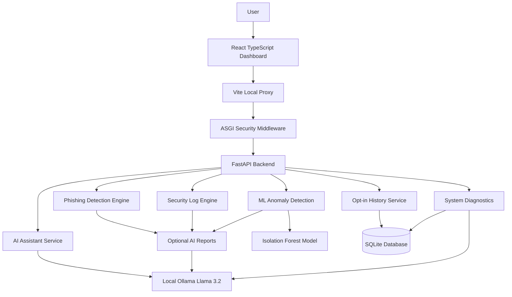
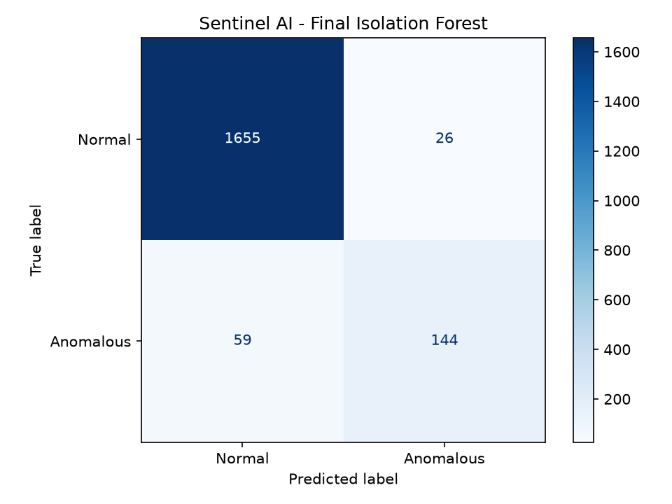
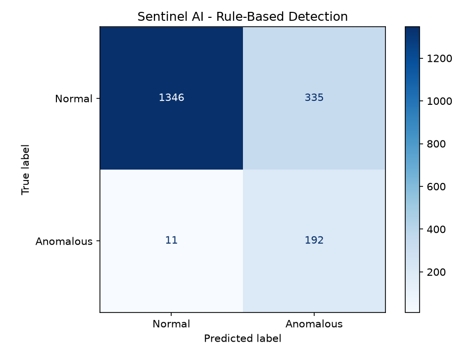

# Sentinel AI

### Local AI-Powered Cybersecurity Intelligence Platform


## Overview

Sentinel AI is a local-first cybersecurity intelligence
platform that combines artificial intelligence, machine
learning, deterministic threat detection, and interactive
security analytics within a unified application.

The platform enables users to investigate suspicious
emails, analyse authentication logs, identify anomalous
login behaviour, generate AI-assisted security reports,
and optionally maintain persistent investigation history.

Unlike applications that depend on cloud-based language
model APIs, Sentinel AI uses a locally hosted language
model through Ollama.

Sentinel AI is designed as a defensive cybersecurity
research and educational project.

---

## Key Features

### AI Cybersecurity Assistant

- Local Llama 3.2 language model integration.
- Context-aware cybersecurity conversations.
- Server-Sent Events for streaming AI responses.
- Markdown rendering and syntax highlighting.
- Temporary and persistent conversation modes.
- Bounded conversation memory.
- Prompt security policies and role validation.

### Phishing Intelligence

- Suspicious keyword detection.
- Credential harvesting indicators.
- Urgency and threat indicator identification.
- Passive URL inspection.
- IP-based URL identification.
- Unencrypted HTTP detection.
- Heuristic risk scoring from 0 to 100.
- Optional AI-generated investigation reports.

### Security Log Analysis

- SSH authentication log parsing.
- Failed and successful login detection.
- IP address aggregation.
- Authentication activity statistics.
- Rule-based brute-force indicators.
- Sliding-window rapid failure detection.
- Interactive security visualisations.

### Machine Learning Anomaly Detection

- Isolation Forest anomaly detection.
- Feature extraction from authentication events.
- Fixed 60-second analysis windows.
- Unsupervised anomaly classification.
- Decision score inspection.
- Rule-based detection comparison.
- Interactive investigation filtering.
- Optional AI-assisted interpretation.

### Persistent Investigation History

- SQLite-based local storage.
- Explicit opt-in history saving.
- Conversation and investigation retrieval.
- Search and filtering.
- Rename and deletion operations.
- Saved AI-generated reports.
- Atomic conversation transactions.
- Transaction rollback on database failure.

### System Diagnostics

- Backend service monitoring.
- Ollama connectivity checks.
- Installed language model discovery.
- ML model file availability checks.
- Database integrity verification.
- Runtime environment information.
- Privacy configuration disclosures.

### Application Security

- Trusted Host header validation.
- Browser origin validation.
- Cross-site request restrictions.
- Maximum request body size enforcement.
- Content-Length validation.
- HTTP security response headers.
- Structured AI investigation payloads.
- Trusted system instruction separation.
- Localhost deployment configuration.

---

## System Architecture



The deterministic detection engines provide structured
security findings independently of the language model.

AI-generated reports are advisory interpretations and
must not replace the underlying detection results.

---

## Technology Stack

| Layer | Technology |
|---|---|
| Frontend | React 19, TypeScript 6 |
| Styling | CSS, Tailwind CSS 4 |
| Visualisation | Recharts |
| Icons | Lucide React |
| Build Tool | Vite 8 |
| Backend | Python 3.12, FastAPI |
| ASGI Server | Uvicorn |
| Language Model | Llama 3.2 |
| Local AI Runtime | Ollama |
| Machine Learning | scikit-learn |
| ML Algorithm | Isolation Forest |
| Data Processing | NumPy, pandas |
| Model Persistence | Joblib |
| Database | SQLite |
| Testing | unittest, FastAPI TestClient |
| Version Control | Git |

---

## Machine Learning Evaluation

Sentinel AI uses an Isolation Forest model to identify
unusual authentication behaviour.

The model analyses five behavioural features:

1. Failed authentication attempts.
2. Successful authentication attempts.
3. Total authentication attempts.
4. Number of unique usernames.
5. Authentication failure rate.

Authentication events are aggregated by IP address
within fixed 60-second windows.

### Experimental Results

The final Isolation Forest model was evaluated against
a rule-based detection baseline using held-out synthetic
authentication data.

| Metric | Isolation Forest | Rule-based |
|---|---:|---:|
| Accuracy | 95.49% | 81.63% |
| Precision | 84.71% | 36.43% |
| Recall | 70.94% | 94.58% |
| F1-score | 77.21% | 52.60% |
| False positive rate | 1.55% | 19.93% |

The Isolation Forest model achieved substantially
higher precision and a lower false positive rate than
the evaluated rule-based baseline.

However, the rule-based approach achieved higher recall,
demonstrating an important trade-off between detection
coverage and false alerts.

### Isolation Forest Confusion Matrix



### Rule-Based Confusion Matrix



### Evaluation Limitations

- The datasets contain synthetic authentication behaviour.
- Results are not representative of guaranteed real-world
  detection performance.
- An anomaly does not necessarily indicate malicious activity.
- Normal classifications do not guarantee system safety.
- Further validation using real-world authentication
  datasets is required.

The evaluation results are available in:

- [Model Comparison](reports/final_model_comparison.csv)
- [Best Configuration](reports/best_configuration_v2.json)
- [Hyperparameter Tuning](reports/tuning_results_v2.csv)

---

## Project Structure

```text
sentinel-ai/
|
|-- backend/
|   |-- api.py
|   |-- ai_service.py
|   |-- config.py
|   |-- security_middleware.py
|   |-- streaming.py
|   |-- persistent_chat.py
|   |-- persistent_investigation.py
|   |-- history_router.py
|   `-- system_router.py
|
|-- database/
|   |-- db.py
|   |-- conversations.py
|   `-- investigations.py
|
|-- security/
|   |-- phishing.py
|   |-- url_analyzer.py
|   |-- risk_engine.py
|   |-- log_analyzer.py
|   |-- log_engine.py
|   |-- threat_detector.py
|   `-- time_analyzer.py
|
|-- ml/
|   |-- generate_dataset_v2.py
|   |-- prepare_data_v2.py
|   |-- tune_model_v2.py
|   |-- train_final_model.py
|   `-- predict_anomaly.py
|
|-- frontend/
|   |-- public/
|   |-- src/
|   |   |-- components/
|   |   |-- services/
|   |   `-- App.tsx
|   |-- package.json
|   `-- vite.config.ts
|
|-- models/
|-- data/
|-- prompts/
|-- reports/
|-- tests/
|-- main.py
|-- requirements.txt
`-- README.md
```

---

## Installation

### Quick Start — Windows

Ensure Python, Node.js, npm and Ollama are installed
and available in your system PATH.

Start Ollama before running the installation script.

Install project dependencies and prepare the application:

```cmd
scripts\setup.bat
```

Launch Sentinel AI:

```cmd
scripts\start.bat
```

The startup script checks the local environment,
launches the backend and frontend services, and
opens the dashboard in your browser.

To stop the application, press Ctrl+C in both
service windows.

### Additional Documentation

- [System Architecture](docs/ARCHITECTURE.md)
- [Security Policy](SECURITY.md)
- [MIT License](LICENSE)

The manual installation instructions are provided below.


### Prerequisites

The following development environment has been tested:

- Windows
- Python 3.12.4
- Node.js 26.13.1
- npm 11.20.0
- Git
- Ollama
- 8 GB RAM

Additional memory and faster processors may improve
local language model inference performance.

### 1. Prepare the Repository

Download or clone the project and open a terminal
inside the project root directory.

### 2. Create a Python Virtual Environment

```cmd
python -m venv .venv
```

Activate the environment on Windows Command Prompt:

```cmd
.venv\Scripts\activate
```

Install the Python dependencies:

```cmd
python -m pip install -r requirements.txt
```

### 3. Install the Local Language Model

Install Ollama from:

https://ollama.com/

Download the configured language model:

```cmd
ollama pull llama3.2:latest
```

Verify the installation:

```cmd
ollama list
```

Ensure that the Ollama service is running before
using AI-assisted functionality.

### 4. Install Frontend Dependencies

```cmd
cd frontend
npm ci
cd ..
```

---

## Running Sentinel AI

### Terminal 1: Backend

Activate the Python virtual environment and run:

```cmd
python -m uvicorn backend.api:app --host 127.0.0.1 --port 8000
```

The backend will be available at:

http://127.0.0.1:8000

### Terminal 2: Frontend

From the project root:

```cmd
cd frontend
npm run dev -- --host 127.0.0.1
```

Open the application:

http://127.0.0.1:5173

The application is designed for local use. Do not
expose the backend directly to public networks.

### Production Frontend Build

```cmd
cd frontend
npm run build
npm run preview -- --host 127.0.0.1
```

Open the preview application:

http://127.0.0.1:4173

The backend must remain running in a separate terminal.

---

## API Reference

Interactive API documentation is available through
FastAPI Swagger UI:

http://127.0.0.1:8000/docs

### Core Endpoints

| Method | Endpoint | Description |
|---|---|---|
| GET | / | Application information |
| GET | /health | Backend health |
| POST | /chat | AI conversation |
| POST | /chat/stream | Streaming AI conversation |
| POST | /phishing | Phishing analysis |
| POST | /logs | Security log analysis |
| POST | /anomaly | ML anomaly detection |

### History Endpoints

| Method | Endpoint | Description |
|---|---|---|
| GET | /history/stats | Storage statistics |
| GET | /history/database | Database information |
| GET | /history/conversations | List conversations |
| POST | /history/conversations | Create conversation |
| GET | /history/conversations/{id} | Retrieve conversation |
| PATCH | /history/conversations/{id} | Rename conversation |
| DELETE | /history/conversations/{id} | Delete conversation |
| GET | /history/investigations | List investigations |
| GET | /history/investigations/{id} | Retrieve investigation |
| PATCH | /history/investigations/{id} | Rename investigation |
| DELETE | /history/investigations/{id} | Delete investigation |

### System Endpoints

| Method | Endpoint | Description |
|---|---|---|
| GET | /system/diagnostics | Combined diagnostics |
| GET | /system/application | Application configuration |
| GET | /system/environment | Runtime information |
| GET | /system/ollama | Ollama status |
| GET | /system/model | ML model availability |
| GET | /system/database | Database health |
| GET | /system/privacy | Privacy information |

---

## Automated Testing

Run the complete backend test suite from the project root:

```cmd
python -m unittest discover -s tests -v
```

The v0.9 release passed 226 automated tests covering:

| Test Area | Tests |
|---|---:|
| Phishing detection | 7 |
| Security log analysis | 11 |
| ML anomaly detection | 10 |
| Core API | 23 |
| Database operations | 30 |
| History API | 20 |
| Persistent conversations | 20 |
| Persistent investigations | 15 |
| System diagnostics | 37 |
| Security middleware | 25 |
| Atomic transactions | 11 |
| AI security boundaries | 17 |
| Total | 226 |

The test suite includes simulated database failures,
request validation, transaction rollback, persistence
controls, and mocked language model interactions.

Mocked tests do not independently establish real-world
language model security or detection performance.

---

## Frontend Performance

Version 0.9 introduced lazy loading for six workspace
modules, separate asset chunks, and workspace-level
error boundaries.

| Asset | Before | After | Reduction |
|---|---:|---:|---:|
| Main JavaScript | 1551.53 kB | 655.78 kB | 57.73% |
| Main CSS | 96.39 kB | 15.32 kB | 84.10% |

These measurements represent initial bundle file sizes,
not measured application startup time or memory usage.

Further JavaScript bundle optimisation remains possible.

---

## Privacy

Sentinel AI follows a local-first processing approach.

- No external AI API is required for the configured model.
- Conversation history saving is disabled by default.
- Investigation history saving is disabled by default.
- Persistent storage requires explicit user selection.
- Temporary operations do not intentionally persist
  conversation or investigation records in SQLite.
- Database files are excluded from Git tracking.

Local SQLite storage is not encrypted.

Users should not submit sensitive production logs,
credentials, confidential emails, or personal data
without appropriate authorisation and safeguards.

Deleting a record does not guarantee secure erasure
from the underlying storage device.

---

## Security Considerations

Sentinel AI implements application-level security
controls intended for a local, single-user environment.

The backend includes:

- Trusted host validation.
- Trusted browser origin validation.
- Cross-site request restrictions.
- A 1 MiB request body limit.
- Content-Length validation.
- HTTP security response headers.
- Atomic database transactions.

The AI service separates trusted system instructions
from untrusted investigation content.

These controls provide defence in depth but do not
guarantee complete resistance to malicious inputs,
prompt injection, or application vulnerabilities.

Only trusted Joblib model files should be loaded.
Untrusted serialized model files may execute arbitrary
code during deserialization.

---

## Known Limitations

- Designed for local, single-user deployment.
- No application-level authentication or authorisation.
- SQLite storage is not encrypted.
- Synthetic machine learning evaluation data.
- Limited SSH authentication log format support.
- Heuristic phishing classifications.
- Language model hallucinations remain possible.
- Prompt injection resistance is not guaranteed.
- Large investigations may exceed the AI report limit.
- Local AI inference can be slow on limited hardware.
- Concurrent requests to the same conversation may
  produce responses using outdated conversation context.
- Interrupted server shutdown may produce cancellation
  tracebacks.
- Some frontend JavaScript chunks remain relatively large.
- Not intended to replace a production SIEM, EDR,
  IDS, or professional security investigation.

---

## Development History

| Version | Milestone |
|---|---|
| v0.1 | Local language model integration |
| v0.2 | Phishing detection engine |
| v0.3 | Security log analysis |
| v0.4 | ML anomaly detection |
| v0.5 | FastAPI backend |
| v0.6 | React cybersecurity dashboard |
| v0.7 | Persistent conversation and investigation history |
| v0.8 | System diagnostics and health monitoring |
| v0.9 | Security, performance, and database reliability |
| v1.0 | Documentation and public release preparation |

---

## Disclaimer

Sentinel AI is intended for defensive cybersecurity
research, educational use, and authorised security analysis.

Its findings and AI-generated recommendations should
be independently verified before taking operational
security actions.

The platform does not automatically block IP addresses,
execute security commands, or modify firewall rules.

---

**Sentinel AI — Local Cybersecurity Intelligence.**
