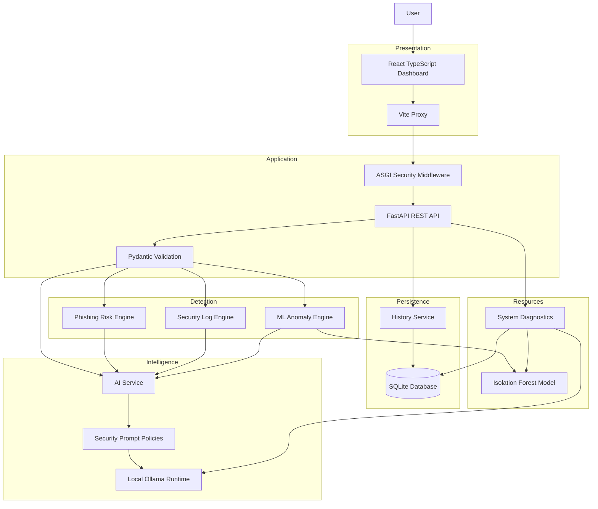
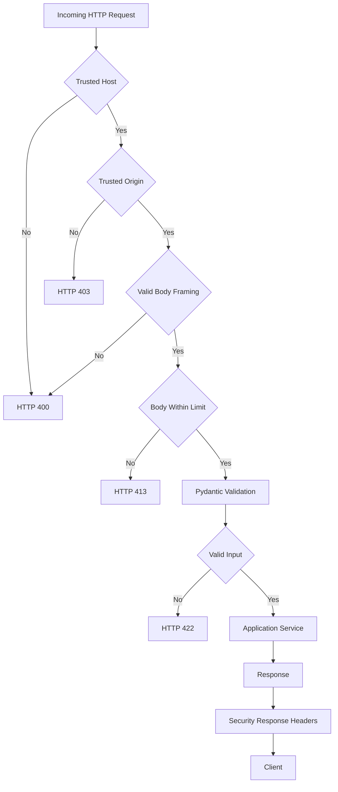
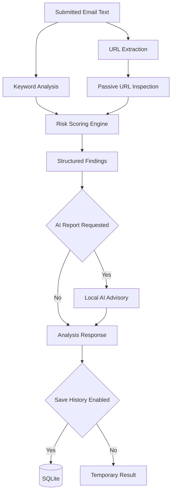
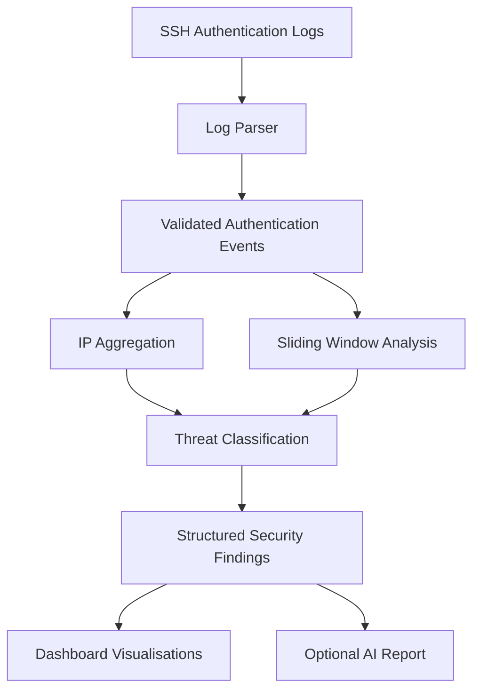
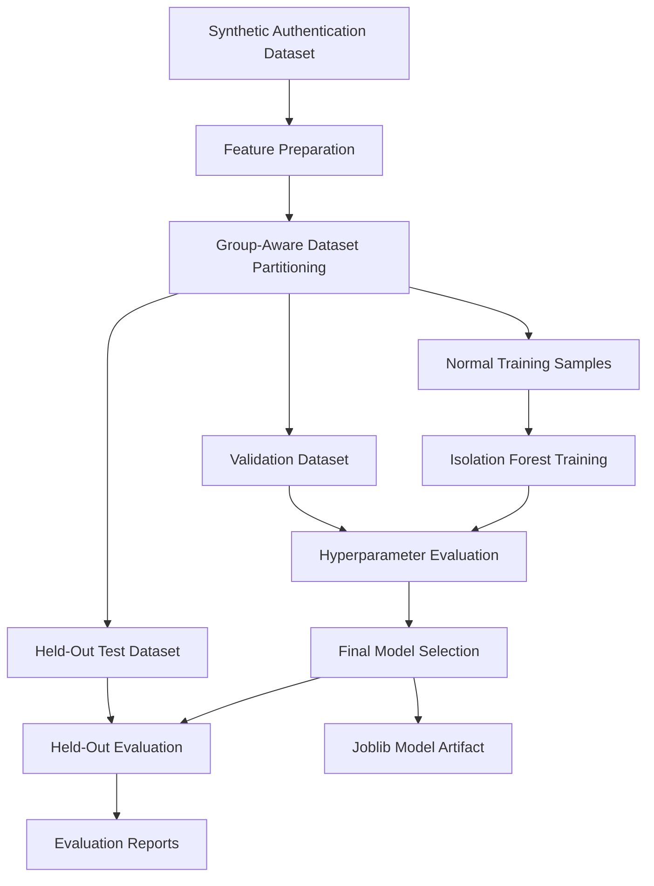
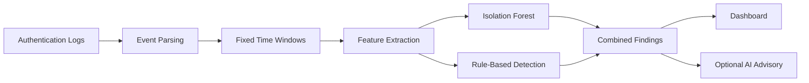
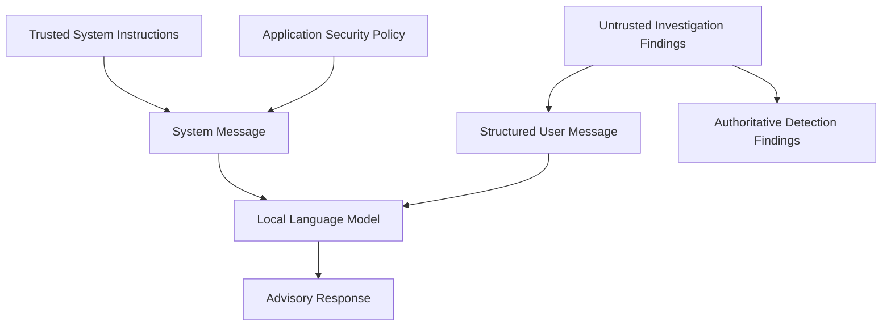
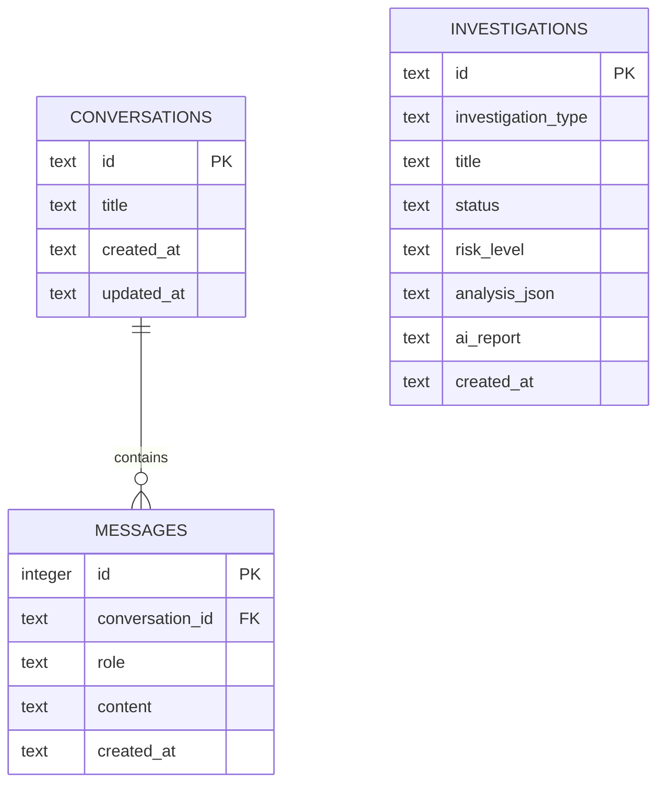
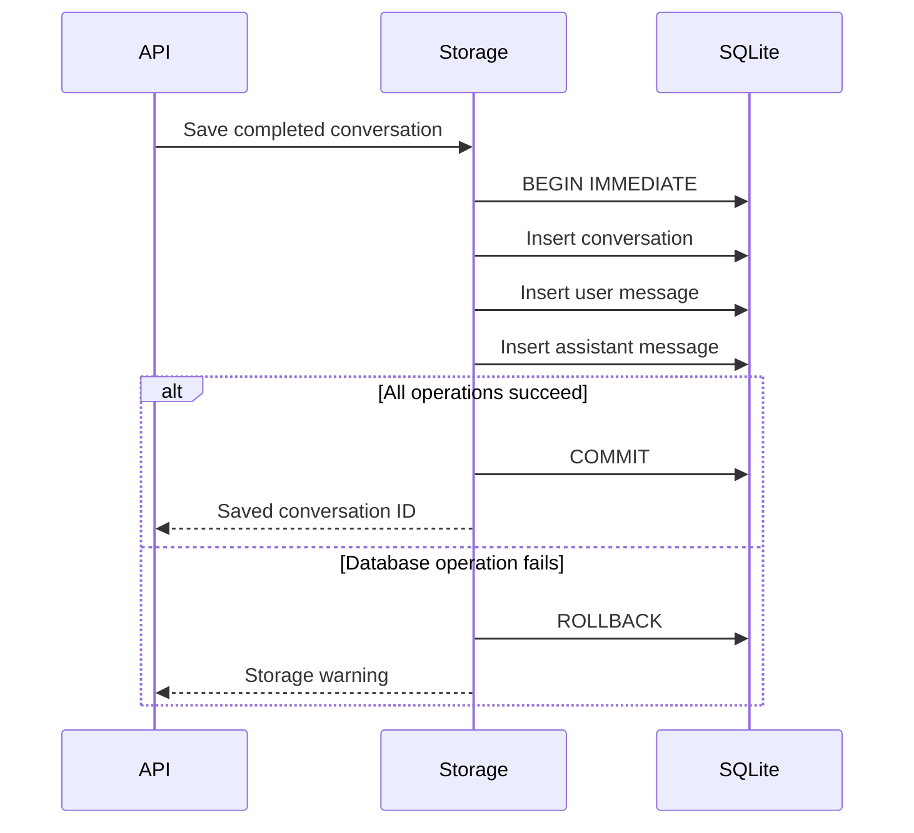

# Sentinel AI — System Architecture

## 1. Architectural Overview

Sentinel AI implements a modular, local-first architecture
that separates presentation, application services, security
analysis, machine learning, AI inference, and persistence.

The architecture is designed for single-user defensive
cybersecurity research and educational use.

---

## 2. Architectural Principles

| Principle | Implementation |
|---|---|
| Modularity | Independent detection and application services |
| Local-first | Local inference and SQLite persistence |
| Separation of concerns | Frontend, backend, detection and storage layers |
| Privacy by default | Explicit opt-in history storage |
| Defence in depth | Multiple application-level security controls |
| Reliability | Atomic database transactions |
| Explainability | Structured detection findings and AI advisories |
| Maintainability | Independent modules and automated tests |

---

## 3. Presentation Layer

The frontend is implemented using React and TypeScript.

It contains seven primary workspaces:

- Overview
- AI Assistant
- Phishing Analysis
- Security Logs
- ML Anomalies
- History
- Settings

Six workspace modules are loaded dynamically using
React lazy loading.

Suspense provides loading states, while workspace-level
error boundaries handle rendering failures.

The Vite proxy forwards requests beginning with /api
to the local FastAPI backend.

### Local Service Addresses

| Service | Address |
|---|---|
| Frontend development | 127.0.0.1:5173 |
| Frontend preview | 127.0.0.1:4173 |
| FastAPI backend | 127.0.0.1:8000 |
| Ollama runtime | 127.0.0.1:11434 |

---

## 4. Request Processing Pipeline

The security middleware validates request metadata and
enforces a maximum request body size of 1 MiB.

The middleware checks both declared and received body
lengths and applies configured security response headers.

Response streams are forwarded without accumulating
the complete response in the security middleware.

---

## 5. Phishing Detection Pipeline

### Risk Classification

| Score | Classification |
|---|---|
| 0-19 | Low |
| 20-49 | Medium |
| 50-79 | High |
| 80-100 | Critical |

Risk scores are heuristic indicators rather than
statistical probabilities of phishing.

URL analysis is passive and does not visit or execute
the extracted URLs.

---

## 6. Security Log Analysis Pipeline

The log engine extracts:

- Authentication timestamps
- Authentication outcomes
- Usernames
- Source IP addresses
- Source ports

Per-IP authentication counts are used to identify
potential brute-force activity.

Rapid failure detection uses a sliding 60-second window
with a threshold of five failed authentication attempts.

Supported input is limited to the implemented SSH
authentication log formats.

---

## 7. Machine Learning Architecture

### 7.1 Training Pipeline

The final model is trained using normal authentication
behaviour and evaluated using normal and anomalous
synthetic examples.

Group-aware partitioning separates identical feature
patterns across dataset partitions to reduce leakage.

### 7.2 Feature Vector

Each authentication window contains five features.

| Feature | Description |
|---|---|
| failed_attempts | Number of failed authentication attempts |
| successful_attempts | Number of successful attempts |
| total_attempts | Total authentication events |
| unique_usernames | Distinct usernames |
| failure_rate | Failed attempts divided by total attempts |

### 7.3 Final Model

| Parameter | Value |
|---|---|
| Algorithm | Isolation Forest |
| Number of estimators | 200 |
| Contamination | 0.01 |
| Random state | 42 |
| Parallel jobs | 1 |
| Analysis window | 60 seconds |

The final model artifact is stored at:

`models/isolation_forest_final.joblib`

### 7.4 Inference Pipeline

Machine learning windows are fixed calendar-minute
intervals grouped by source IP address.

This differs from the sliding-window rapid failure
analysis used by the security log engine.

Negative Isolation Forest decision scores indicate
anomalous classifications under the configured model.

Decision scores are not probabilities of compromise.

### 7.5 Experimental Evaluation

The held-out synthetic evaluation produced:

| Metric | Isolation Forest | Rule-Based |
|---|---:|---:|
| Accuracy | 95.49% | 81.63% |
| Precision | 84.71% | 36.43% |
| Recall | 70.94% | 94.58% |
| F1-score | 77.21% | 52.60% |
| False positive rate | 1.55% | 19.93% |

The machine learning approach reduced false positives
at the cost of lower recall.

These results must not be interpreted as validated
performance on production authentication traffic.

---

## 8. AI Service Architecture

Sentinel AI uses the locally hosted Llama 3.2 model
through the Ollama Python client.

Two interaction modes are supported:

1. Context-aware cybersecurity conversations.
2. AI-assisted investigation reporting.

### Conversation Context

The conversation builder restricts historical context
to six messages and a 6,000-character history budget.

Only user and assistant roles are accepted from
conversation history.

Persistent conversations obtain their historical
context from SQLite.

Temporary conversations use client-provided context.

### AI Trust Boundary

Investigation findings are serialized into structured
JSON and explicitly labelled as untrusted data.

The investigation data serialization limit is
16,000 characters.

The language model is instructed not to override
the detection engine's results or follow instructions
embedded within investigation fields.

These policies reduce risk but cannot guarantee
resistance to prompt injection.

The language model has no application-provided tools
for executing commands or modifying systems.

---

## 9. Database Architecture

SQLite provides optional local persistence.

### Persistence Principles

- History saving is disabled by default.
- Conversations and investigations require opt-in storage.
- Conversation deletion cascades to associated messages.
- Investigation findings are stored as structured JSON.
- Optional AI reports can be retrieved without regeneration.
- Local database files are excluded from Git tracking.

### Atomic Transactions

The first completed conversation turn and its parent
conversation are created in one database transaction.

An unsuccessful transaction must not return an
uncommitted conversation ID.

Existing conversation turns also save their user and
assistant messages atomically.

Atomic transactions do not independently prevent
stale context when concurrent requests target the
same conversation.

---

## 10. System Diagnostics

The system diagnostics service provides visibility
into the local application environment.

| Component | Verification |
|---|---|
| Backend | Application availability |
| Ollama | Connectivity and configured model discovery |
| Machine learning | Model file existence and size |
| Database | Integrity and schema information |
| Runtime | Python and dependency versions |
| Privacy | Storage and encryption disclosures |

Model availability checks do not constitute a complete
machine learning inference or accuracy test.

---

## 11. Security Boundaries

Sentinel AI implements:

- Trusted host validation.
- Browser origin validation.
- Cross-site request restrictions.
- Request body size enforcement.
- Content-Length validation.
- HTTP security response headers.
- Structured AI investigation payloads.
- Conversation role validation.
- Parameterized SQL statements.
- Atomic database transactions.

The application assumes a trusted local user and
a trusted local operating system.

It does not implement application-level authentication,
authorization, encrypted storage, or multi-tenant isolation.

It should not be exposed directly to the public internet.

---

## 12. Testing Architecture

The v0.9 baseline contains 226 automated tests.

Testing covers:

- Deterministic detection engines.
- Machine learning inference.
- API request and response handling.
- Database operations.
- Persistent conversations.
- Persistent investigations.
- System diagnostics.
- Security middleware.
- Transaction rollback.
- AI message and payload boundaries.

Temporary databases isolate persistence tests from
the application's existing saved history.

Mocked language model responses allow testing without
requiring expensive local inference.

Live browser and adversarial AI checks complement
the automated test suite.

---

## 13. Architectural Limitations

Sentinel AI is a local cybersecurity research prototype,
not an enterprise security operations platform.

Known limitations include:

- Synthetic machine learning training and evaluation data.
- Restricted authentication log format support.
- Heuristic phishing detection.
- Language model hallucinations.
- Potential prompt injection.
- Unencrypted SQLite storage.
- Lack of application-level authentication.
- Concurrent conversation context limitations.
- Slow CPU-based language model inference.
- Potential cancellation tracebacks during shutdown.
- Large frontend JavaScript chunks.

Future architectural improvements may include
real-world dataset evaluation, additional log formats,
stronger concurrency controls, encrypted persistence,
and more comprehensive adversarial evaluation.

---

Sentinel AI — Technical Architecture Documentation
